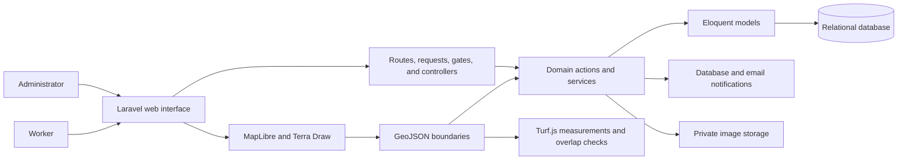

# Farm Management System - Project Showcase

A private-source web application for coordinating day-to-day farm operations across fields, workers, tasks, work records, and reported problems.

This public repository is a portfolio showcase only. It intentionally contains no application source code, environment files, credentials, database exports, real farm records, or private user data.

## Project overview

The system models real operational workflows for two roles:

- **Administrators** manage workers, farm records, tasks, reviews, corrections, and operational follow-up.
- **Workers** access their assigned work, track activity, submit results, request task changes, and report field problems.

The application is being developed as a structured Laravel project with server-side authorization, relational data models, explicit workflow rules, and automated tests around important permissions and state changes.

## Verified capabilities

### Access and worker management

- Administrator and Worker roles with server-side authorization
- Worker account creation, secure setup links, activation, deactivation, and reactivation
- Active-account enforcement and ownership checks
- Preserved historical records when a worker becomes inactive

### Task workflows

- Task creation with field, priority, deadline, expected duration, instructions, and expected result
- Assignment of multiple workers to one task
- Independent assignment status for each worker
- Start, submit, review, approve, reject, correct, remove, and cancel workflows
- Worker requests to leave an assignment or request full task cancellation
- Task dependencies and readiness checks
- Database and email notifications for important workflow events
- Audit history for operational changes

### Farm and field management

- Fields, crops, and crop seasons stored through relational models
- Interactive MapLibre field maps
- GeoJSON polygon boundaries with server-side validation
- Turf.js area, perimeter, distance, and overlap calculations
- Server-side area calculation from the saved polygon boundary
- Read-only neighboring field context while drawing or editing a boundary

### Work tracking and problem reporting

- Worker check-in and check-out sessions
- Per-task work timers and recorded work segments
- Administrator time corrections with a required reason and audit history
- Worker problem reports linked to fields, crop seasons, and optionally a source task
- Review, prioritization, resolution, rejection, and task-creation workflows for reported problems
- Authorized private image access for task evidence and problem reports

## Technology

- **Backend:** PHP, Laravel, Livewire, Laravel Fortify
- **Database:** MySQL for application development; relational migrations and isolated automated test databases
- **Frontend:** Blade, Livewire, JavaScript, Tailwind CSS, Flux UI
- **Mapping:** MapLibre GL JS, GeoJSON, Turf.js, Terra Draw
- **Quality:** Pest, PHPUnit, Larastan, Laravel Pint, Node.js tests, GitHub Actions configuration

REST API concepts are part of the developer's learning path, but this showcase does not claim that a public REST API has been implemented.

## Architecture overview

## Engineering decisions

- Authorization is enforced on the server rather than relying on hidden interface controls.
- Workflow changes use transactions and row locking where related records must remain consistent.
- Task progress is calculated from active worker assignments instead of a single manual status field.
- Submission attempts, cancellation requests, worker history, and audit events are preserved for traceability.
- Field area is derived from the stored polygon, preventing a browser-supplied number from becoming the source of truth.
- Uploaded evidence is stored privately and served only after authorization checks.
- Public self-registration is disabled; worker access follows an administrator-managed setup flow.

## Quality and verification

The private project includes feature and unit tests covering role boundaries, worker lifecycle rules, task state transitions, notifications, field geometry, work tracking, problem reporting, private uploads, and historical-record preservation.

The next repository-quality milestone is to review the active feature branch through a pull request and run the configured continuous-integration checks before merging it into the default branch.

## Privacy and public demo policy

Any future screenshots or video demonstrations will use fictional names, fields, tasks, and farm data. Real accounts, contact details, locations, credentials, tokens, environment values, and operational records will not be published.

## Planned extensions

The following are ideas for later work, not completed features:

- IoT and sensor integration
- ESP32-based field devices
- Operational automation
- Advanced analytics
- AI-assisted predictions

## About the developer

**Charbel Kanj** is a Computer Science student at Arab Open University in Lebanon, focused on software development and backend engineering with PHP, Laravel, and MySQL.

- [GitHub](https://github.com/charbelkanj)
- [LinkedIn](https://www.linkedin.com/in/charbel-kanj-43772a41b/)
- [Email](mailto:charbelkanj.dev@gmail.com)

## Copyright

Copyright (c) 2026 Charbel Kanj. All rights reserved.

The application source code remains private. Public descriptions and future screenshots can still be viewed, downloaded, or copied; this notice states ownership but is not a technical copying barrier.

